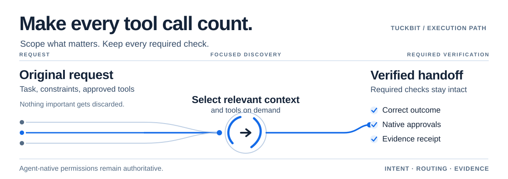

<div align="center">

<picture>
  <source media="(prefers-color-scheme: dark)" srcset="assets/branding/tuckbit-logo-dark.png">
  <source media="(prefers-color-scheme: light)" srcset="assets/branding/tuckbit-logo-light.png">
  
</picture>

### Every tool. Right on cue.

**Make your AI coding agent more deliberate about context, tools, and verification.**

TuckBit is an open-source Agent Skill and optional local tooling for task-aware coding workflows. It guides agents toward the relevant evidence and the necessary checks—**without bypassing their own permissions**.

**[Copy the agent install prompt](#install-with-your-ai-agent-no-cli-required)** · **[Install with a command](#install-with-a-command)** · **[How it works](#how-it-works)** · **[Benchmarks](docs/PUBLIC_BENCHMARK_PROTOCOL.md)**

[](https://github.com/MakeItEzzz555/tuck-bit/actions/workflows/tests.yml)
[](LICENSE)
[](docs/ROADMAP.md)

</div>

<div align="center">
<picture>
  <source media="(max-width: 600px) and (prefers-color-scheme: dark)" srcset="assets/branding/tuckbit-flow-dark-mobile.svg">
  <source media="(max-width: 600px) and (prefers-color-scheme: light)" srcset="assets/branding/tuckbit-flow-light-mobile.svg">
  <source media="(prefers-color-scheme: dark)" srcset="assets/branding/tuckbit-flow-dark.svg">
  <source media="(prefers-color-scheme: light)" srcset="assets/branding/tuckbit-flow-light.svg">
  
</picture>
</div>

**New: optional TuckBit Observatory public preview.** Inspect a synthetic demo or explicitly select one local Codex JSONL/normalized JSON export through a loopback-only browser UI. No background capture, remote server, private research receipts or verified billing claims. [Local setup and limitations](docs/OBSERVATORY_PUBLIC.md). Start locally with `python3 scripts/dashboard_server.py --port 8765`.

**Public developer preview.** The portable skill, metadata discovery, reversible installer, deterministic router and offline benchmark harness are available. Real cross-provider activation, live tool interception, and verified token savings are **not** established. [See what's implemented](#what-is-actually-implemented) and the [public roadmap](docs/ROADMAP.md).

<details>
<summary><strong>Read in 14 languages</strong></summary>

**Languages:** [English](README.md) · [Español](docs/i18n/es/README.md) · [Français](docs/i18n/fr/README.md) · [Deutsch](docs/i18n/de/README.md) · [Português](docs/i18n/pt/README.md) · [Italiano](docs/i18n/it/README.md) · [Ελληνικά](docs/i18n/el/README.md) · [Türkçe](docs/i18n/tr/README.md) · [Русский](docs/i18n/ru/README.md) · [العربية](docs/i18n/ar/README.md) · [हिन्दी](docs/i18n/hi/README.md) · [日本語](docs/i18n/ja/README.md) · [한국어](docs/i18n/ko/README.md) · [简体中文](docs/i18n/zh-CN/README.md) · [繁體中文](docs/i18n/zh-TW/README.md)

*Localization is opt-in and remains a preview; some technical reference content falls back to English.* [Localization details](docs/i18n/README.md).

</details>

---

## Install with your AI agent (no CLI required)

**New to GitHub or terminals?** Copy the text below into a coding agent that can access your project files and run commands, such as Codex, Claude Code or another compatible agent. It should explain what it will do and ask for permission before making changes.

<!-- AGENT_INSTALL_PROMPT_START -->
```text
Help me install TuckBit as an optional Agent Skill in my CURRENT project.
Source: https://github.com/MakeItEzzz555/tuck-bit

1. First inspect TuckBit's README, skills/tuck-bit/SKILL.md and installation/compatibility documentation from this official repository. Do not trust unknown mirrors.
2. Identify which coding-agent host and project skill directory I am using. Prefer a supported, project-scoped installation over a global one.
3. Show me the files and settings you would change, and ask my approval before downloads, dependency installs, file modifications or any other tool commands.
4. Prefer the documented Agent Skills installer when supported (npx skills add MakeItEzzz555/tuck-bit), or the repository's reversible Python installer with a dry run first. If neither is available, explain a manual copy option; do not invent unsupported commands.
5. Preserve existing skills/configurations. Do not overwrite them, install global hooks/MCP servers, enable telemetry, access credentials, or change unrelated projects without specific permission.
6. After approved installation, verify the project-scoped SKILL.md is present. Explain when I can ask the agent to use TuckBit and what remains unverified (installation alone does not prove automatic model activation).

If any step is unsupported or unsafe, stop and explain the alternative rather than guessing.
```
<!-- AGENT_INSTALL_PROMPT_END -->

**What this does:** asks *your own* agent to plan and verify installation. Pasting it here does not install anything automatically, and your agent must have appropriate file/tool capabilities. **No global configuration changes are authorized by this prompt.** [Detailed prompt and safety notes](docs/AGENT_INSTALL_PROMPT.md).

## Install with a command

If you are comfortable with a terminal, first preview the portable skill:

```bash
npx skills add MakeItEzzz555/tuck-bit --list
```

Then install it with the community Agent Skills installer (select the client and scope it supports):

```bash
npx skills add MakeItEzzz555/tuck-bit
```

Installation is distinct from successful model-driven activation. Inspect the source first; don't grant unexpected filesystem, credential or network access. For a **dry-run project-scoped Python installer** and rollback instructions, see [install details](docs/TESTING.md) and [compatibility](docs/COMPATIBILITY.md).

## Why TuckBit exists

A simple coding request can become repeated repository scans, entire tool catalogs in context, several agents rereading the same files, or unnecessary test loops. TuckBit's goal is to **reduce unproductive work, not required reasoning or checks**.

| Without task-aware guidance | TuckBit's intended guidance |
|---|---|
| Load everything before you know what's needed | Discover only relevant skills, files and tools |
| Delegate small changes to several agents | Start with one worker; parallelize only independent work |
| Repeat reads and tests without inspecting inputs | Reuse valid evidence; rerun checks when dependencies change |
| Optimize token counts regardless of quality | Preserve correctness, approval boundaries and mandatory verification |

These are design goals and guidance, **not measured before/after outcomes**. [Benchmark methodology](docs/PUBLIC_BENCHMARK_PROTOCOL.md) · [Public example](evals/results/offline-v1.example.json).

## How it works

| 01 — Preserve intent | 02 — Route deliberately | 03 — Verify the result |
|---|---|---|
| Keep the user request, project instructions, constraints and required checks intact. | Recommend relevant tools, scoped evidence, and a Fast / Standard / Deep approach. | Run required validation; return changed files, test results and remaining limitations. |

TuckBit's portable skill provides **advisory guidance** when your host loads it. The optional local router accepts explicitly supplied task data; it does **not** inspect hidden reasoning, automatically intercept agent calls or grant tool permissions. **Single** is the default workflow; **Parallel**, **Continuous** and **Review-only** require appropriate scope or consent.

[Read the architecture](docs/ARCHITECTURE.md) · [Agent-specific policies](docs/PROVIDER_EXECUTION.md) · [Security and privacy](docs/PRIVACY.md)

## The six capabilities

| Capability | Default | What it guides |
|---|---|---|
| **Tool discovery** | On | Find relevant skills and MCP tools *on demand*; prefer native search |
| **Context control** | On | Load targeted evidence; use compact handoffs and checkpoints |
| **Verification** | On | Test changed behavior without skipping mandatory safety/release gates |
| **Execution budgets** | On | Reconsider unproductive calls, repeated output, retries and unnecessary delegation |
| **Agent orchestration** | Opt-in | Split genuinely independent tasks by ownership and integrate results |
| **Metrics & evaluation** | Opt-in | Compare successful outcomes, context, tokens, tool calls and latency |

No background service is required for the portable skill. TuckBit does not grant itself access to credentials, private reasoning, or tools the host hasn't authorized.

## Developer tooling (optional)

TuckBit's no-model router and profiler require the full repository checkout. They do not silently inspect active global instructions or launch model sessions.

```bash
git clone https://github.com/MakeItEzzz555/tuck-bit.git
cd tuck-bit
python3 scripts/tuckbit.py doctor
python3 scripts/workflow_router.py examples/workflow-incident.json
```

For a project-only installation preview without changing agent settings:

```bash
python3 scripts/install.py install --scope project --project /path/to/your-project --client codex --dry-run
```

[Full CLI usage, rollback and tests](docs/TESTING.md).

## Local capability index and execution profiling

The **full source checkout** now includes opt-in, read-only metadata discovery and redacted event profiling. The registry indexes only explicitly selected skill roots and optional tool catalogs; it never contacts MCP servers or activates tools. The standalone Agent Skill installation remains instruction-only: root-level Python CLI utilities are **not yet bundled** into the portable skill package.

```bash
# Index this repository's skill and a synthetic, nonsecret tool catalog.
python3 scripts/capability_registry.py build \
  --root skills \
  --tools-file examples/tool-metadata.synthetic.json \
  --output /tmp/tuckbit-preview-index.json

# Find candidates (metadata only), and ensure the snapshot is still fresh.
python3 scripts/capability_registry.py query \
  --snapshot /tmp/tuckbit-preview-index.json \
  --text "Swift regression tests"
python3 scripts/capability_registry.py verify \
  --snapshot /tmp/tuckbit-preview-index.json \
  --root skills --tools-file examples/tool-metadata.synthetic.json

# Supply a catalog and optional redacted observations to the task router.
python3 scripts/workflow_router.py examples/workflow-incident.json \
  --registry-snapshot /tmp/tuckbit-preview-index.json \
  --trace examples/trace-baseline.synthetic.json
```

A lightweight profiler compares caller-supplied numeric trace summaries without accepting raw prompts, logs, or tool arguments:

```bash
python3 scripts/trace_profiler.py compare \
  --baseline examples/trace-baseline.synthetic.json \
  --candidate examples/trace-candidate.synthetic.json
```

The trace files above are **synthetic test fixtures, not real token savings**. No user-agent session is queried. See [metadata registry](docs/CAPABILITY_REGISTRY.md) and [safe telemetry](docs/TELEMETRY.md).

## Reproducible benchmark bundles (offline harness preview)

TuckBit now includes a **no-model, repeated-task harness** for testing evaluation infrastructure. It builds a disposable Git fixture, creates a **fresh worktree from the same commit for every trial**, alternates baseline/treatment order, and reports correctness and operation/time distributions for each task.

```bash
python3 scripts/repeat_bundle.py \
  --bundle evals/bundles/offline-v1.json \
  --output /tmp/tuckbit-offline-run.json
```

The example contains **three tasks, four repetitions, two identical Python conditions** (24 offline trials). This is **not an AI-agent benchmark**, and token/cost/human-review metrics are unavailable. The real next step is a consent-based, provider-native repeated-run adapter. See [reproducible bundle methodology](docs/REPRODUCIBLE_BUNDLES.md) and [the example result](evals/results/offline-v1.example.json).

## Agent support

**One canonical Agent Skill. Provider-specific policies only where the runtime genuinely differs.**

| Agent ecosystem | Distribution | Execution guidance |
|---|---|---|
| **Codex** | Portable skill + plugin/local marketplace manifests | Direct requests, scoped discovery, appropriate reasoning settings |
| **Claude Code** | Plugin + marketplace | Native tool search, adaptive effort, compact subagent handoffs |
| **Gemini CLI** | Extension + skill | Consent-based activation, bounded tools/turns for subagents |
| **Cursor** | Portable Agent Plugin/skill | Context-isolated subagents; separate local/cloud concerns |
| **OpenCode** | Portable skill | Plan/build separation, native on-demand skills, permissions |
| **GitHub Copilot** | Portable skill | Well-scoped issues, project instructions, PR/CI evidence |
| **Other Agent Skills hosts** | Standard `SKILL.md` | Conservative portable fallback |

The manifests and local skill discovery are tested, but native inference-driven activation **has not been validated** across all these clients. [Compatibility matrix](docs/COMPATIBILITY.md).

## Real-world workflow choices

<details>
<summary><strong>🔧 Small bug — Fast / Single</strong></summary>

Locate one behavior, inspect connected contracts, implement the narrowest complete fix, run the focused test, review diff and stop. Don't create a whole team for a one-line change.

</details>

<details>
<summary><strong>🧠 Authentication race — Deep / Single</strong></summary>

Preserve session invariants and rollback options; inspect ownership and data flow; implement incrementally; run required security and regression checks. An execution budget never cancels mandatory verification.

```bash
python3 scripts/workflow_router.py examples/workflow-incident.json
```

</details>

<details>
<summary><strong>🎻 Independent changes — Parallel (opt-in)</strong></summary>

Assign separate file ownership, exact deliverables and tests. Workers return evidence rather than full transcripts. The coordinator integrates and validates the result.

```bash
python3 scripts/workflow_router.py examples/workflow-parallel.json
```

</details>

<details>
<summary><strong>🔁 Recurring maintenance — Event-driven (opt-in)</strong></summary>

Require a genuine trigger, saved checkpoint and explicit authorization. An idle workflow shouldn't burn model turns polling for something to happen.

```bash
python3 scripts/workflow_router.py examples/workflow-loop.json
```

</details>

## What is actually implemented?

| Engineering milestone | Status |
|---|---|
| Canonical Agent Skill and progressive instructions | ✅ |
| Portable plugin, Claude marketplace, Codex and Gemini manifests | ✅ structural packaging |
| Reversible six-client project/global installer | ✅ tested in isolated directories |
| Declarative task-contract and workflow router | ✅ deterministic, no-model |
| Provider research and host policies | ✅ published-source grounded |
| Opt-in Claude/Gemini prompt-entry advisors | ✅ Prototype, no automatic registration |
| Local skill/MCP metadata index and freshness verification | ✅ explicit inputs, read-only |
| Redacted event profiling and router signals | ✅ explicit inputs, deterministic |
| Native tool-call interception / adaptive control | Planned — opt-in |
| Benchmarked token/cost savings without quality loss | Not yet established |
| Public marketplace listings, npm release, website | Not published |

Run all local checks at zero model-token cost:

```bash
python3 -m unittest discover -s tests -v
python3 scripts/public_audit.py
python3 scripts/sync_distributions.py --check
python3 scripts/smoke_free.py --interop --claude-validator
```

The last command may use npm/network for the public `skills` package; it still launches no language model.

## Why this isn't another orchestration framework

TuckBit is designed to **work with** native agent features instead of wrapping every task in another expensive coordination loop. It's an efficiency *policy and capability layer*, not a replacement for Codex, Claude, Gemini, or their existing skills.

It deliberately prioritizes:
- **Instructions before automation:** start from the full prompt and genuine host constraints.
- **Useful evidence over broad context:** only request more when it changes the answer.
- **One capable worker over unnecessary agents:** parallelism must justify its coordination overhead.
- **Verified quality over vanity metrics:** no made-up cost reduction graphs or “10×” claims.
- **Reversibility and local privacy:** no silent global hooks, credentials indexing or background scraping.

## Help build the next version

We'd especially value feedback from people who use **Codex, Claude Code, Gemini CLI, Cursor, OpenCode, or Copilot** on real repositories.

- Reproducible **native skill activation** reports using non-sensitive sample projects.
- Public benchmark tasks comparing equivalent *correct outcomes*.
- Reviews of install/uninstall paths, hook opt-in boundaries and untrusted skill/MCP metadata.
- Provider documentation fixes, regression tests and onboarding improvements.

**[Report a bug or feature request](https://github.com/MakeItEzzz555/tuck-bit/issues/new/choose)** · **[Browse issues](https://github.com/MakeItEzzz555/tuck-bit/issues)** · **[Join discussions](https://github.com/MakeItEzzz555/tuck-bit/discussions)**

For security vulnerabilities, use GitHub **private vulnerability reporting** rather than a public issue; see [SECURITY.md](SECURITY.md).

## Research, architecture and contribution

[Privacy](docs/PRIVACY.md) · [Capability index](docs/CAPABILITY_REGISTRY.md) · [Profiler](docs/TELEMETRY.md) · [Provider execution research](docs/PROVIDER_EXECUTION.md) · [Opt-in hook adapters](docs/HOOKS.md) · [Task-aware design](docs/TASK_AWARE.md) · [Architecture](docs/ARCHITECTURE.md) · [Roadmap](docs/ROADMAP.md) · [Security](SECURITY.md) · [Tests](docs/TESTING.md) · [Contributing](CONTRIBUTING.md)

TuckBit is **public and MIT-licensed**, but remains an early developer preview. Contributions, issue reports and reproducible experiments are welcome. Please read [CONTRIBUTING.md](CONTRIBUTING.md), the [public roadmap](docs/ROADMAP.md), and [SECURITY.md](SECURITY.md) before sharing logs or code.

---

<div align="center">

**TuckBit — make every tool call count.**

*Not fewer checks. Fewer wasted moves.*

</div>
